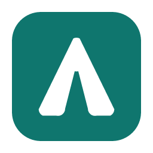

<p align="center">
  
</p>

<h1 align="center">OxVault</h1>

<p align="center">
  <strong>A modern, unofficial Bitwarden client.</strong>
</p>

<p align="center">
  <a href="https://n1klaus.github.io/oxvault">Website</a> ·
  <a href="#highlights">Highlights</a> ·
  <a href="#screenshots">Screenshots</a> ·
  <a href="#installation">Installation</a> ·
  <a href="#development">Development</a>
</p>

<p align="center">
  
</p>

OxVault is an alternative client for your existing Bitwarden vault, designed around a cleaner interface and quicker workflows. Search from the keyboard, fill logins in your browser, and access credentials from Raycast. Keep your account and vault; there's nothing to migrate.

OxVault is an independent project, not affiliated with or endorsed by Bitwarden. OxVault starts from [bodencrouch/strongroom](https://github.com/bodencrouch/strongroom), which started from [dillionverma/bitlatch](https://github.com/dillionverma/bitlatch) at v0.3.5. Both are MIT licensed; their notices stay in [LICENSE](LICENSE).

## Highlights

- ✨ **A more considered interface.** Clear layouts, system colors, and native vibrancy on macOS.
- ⚡ **Keep your hands on the keyboard.** Jump to search with ⌘K / Ctrl+K, find a login, and copy what you need.
- 🌐 **Fill where you browse.** Bring OxVault to Chrome, Aside, and other browsers. [See browser availability](#browser-extensions).
- 🚀 **Your vault in Raycast.** Search, unlock, and copy credentials straight from your launcher on Mac.
- 👆 **Less typing, more control.** Unlock with Touch ID on Mac, choose when your vault locks, and configure generated passwords.
- 🔑 **Keep Bitwarden underneath.** Your existing account and vault, with authentication and cryptography handled by the official Bitwarden CLI.

## Screenshots

<p align="center">
  
  
</p>

<p align="center">
  
</p>

## Installation

### Homebrew

```sh
brew install bitwarden-cli
```

Prebuilt desktop packages are not published yet; see [Installation](#installation) to build from source.

### Direct download

- <picture><source media="(prefers-color-scheme: dark)" srcset="https://cdn.jsdelivr.net/gh/pheralb/svgl@ed75393dbe6eba6e446e208abb6826ecd1abd36d/static/library/apple_dark.svg" /></picture> **macOS 14+ · Apple Silicon:** [DMG](https://github.com/n1klaus/oxvault/releases/download/v0.3.5/OxVault-0.3.5-mac-arm64.dmg)
-  **Windows · x64:** [Installer](https://github.com/n1klaus/oxvault/releases/download/v0.3.5/OxVault-0.3.5-win-x64.exe) · experimental
-  **Linux · x64 / ARM64:** [AppImage & deb](https://github.com/n1klaus/oxvault/releases/tag/v0.3.5) · experimental

### Browser extensions

The extensions connect to the macOS app. Windows and Linux builds cannot yet check which app asks for a password, so they do not accept browser connections.

-  Chrome,  Edge,  Brave,  Arc, Aside,  Vivaldi &  Chromium: [Download](https://github.com/n1klaus/oxvault/releases/download/v0.3.5/oxvault-0.3.5-chrome.zip) · [Setup](https://developer.chrome.com/docs/extensions/get-started/tutorial/hello-world#load-unpacked)
-  **Firefox preview:** [Download](https://github.com/n1klaus/oxvault/releases/download/v0.3.5/oxvault-0.3.5-firefox.zip) · [Setup](https://extensionworkshop.com/documentation/develop/temporary-installation-in-firefox/)

###  Raycast

[Download source ZIP](https://github.com/n1klaus/oxvault/releases/download/v0.3.5/oxvault-0.3.5-raycast.zip) · [Setup](apps/raycast/README.md#install-from-source). Store installation coming soon.

## Privacy and network use

OxVault makes outbound requests only to your configured vault server through `bw` and for website icons: the desktop app fetches icons directly from the vault server's own `/icons/<host>/icon.png` endpoint, using `icons.bitwarden.net` and `icons.bitwarden.eu` only for cloud `vault.bitwarden.com` and `vault.bitwarden.eu` accounts. Breach and inactive 2FA lookups are off by default. Full details: [Privacy and network use](https://n1klaus.github.io/oxvault/privacy/).

## Development

```sh
git clone https://github.com/n1klaus/oxvault.git
cd oxvault
pnpm install --frozen-lockfile
pnpm run dev
```

Run `pnpm run check` and `pnpm run build` before submitting changes.

### Bitwarden CLI

OxVault runs your installed Bitwarden CLI rather than shipping its own cryptography. The CLI must start as an unpackaged Node program, because OxVault passes secrets to it through a preload script that packaged and sandboxed builds ignore:

```sh
npm install -g @bitwarden/cli
```

A packaged `bw` fails the check with “This Bitwarden CLI cannot receive keys privately”, naming the path it found. The snap package is one of these: `snap install bw` installs `/snap/bin/bw`, a single self-contained binary that ignores `NODE_OPTIONS`, so OxVault skips it and reports the npm CLI instead. Remove it (`snap remove bw`) so the npm copy wins on `PATH`. `OXVAULT_BW_PATH` overrides lookup when you keep the CLI somewhere else.

### Linux sandbox

Electron needs a usable sandbox. Ubuntu 23.10+ restricts unprivileged user namespaces through AppArmor, and Electron does not ship its SUID helper as root-owned, so a plain `pnpm run dev` aborts with:

```
FATAL:sandbox/linux/suid/client/setuid_sandbox_host.cc:166] The SUID sandbox helper binary was found, but is not configured correctly.
```

Fix the sandbox once (each Electron reinstall resets it):

```sh
sudo chown root:root node_modules/electron/dist/chrome-sandbox
sudo chmod 4755 node_modules/electron/dist/chrome-sandbox
```

Or lift the namespace restriction for the whole machine until the next reboot (it reopens user namespaces for every process, so prefer the per-binary fix):

```sh
sudo sysctl kernel.apparmor_restrict_unprivileged_userns=0
```

For local development only, you can skip the OS sandbox instead:

```sh
pnpm run dev --no-sandbox
pnpm run start --no-sandbox
```

Do not write `--` before the flag: `pnpm run dev -- --no-sandbox` turns it into an app argument and Electron still aborts. Never ship a build that disables the sandbox. After a crash, a stale `~/.config/OxVault/SingletonLock` can make the next launch fail with `SingletonLock: File exists`; delete it.

[Release workflow](.github/workflows/release.yml)

## License

[MIT](LICENSE).
